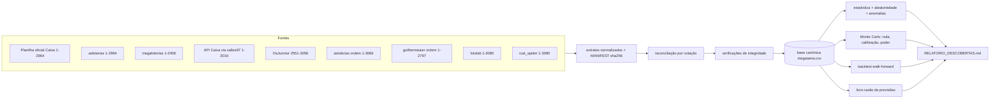

# 02 — Arquitetura proposta do MEGA LAB

## Princípios de projeto

1. **Reprodutibilidade:** toda saída (base, relatórios, figuras, previsões)
   é gerada por um comando, com sementes fixas, e carrega o hash SHA-256 da
   base de dados usada.
2. **Causalidade estrita:** nenhum modelo ou feature pode ver o concurso que
   está prevendo. Isso é garantido por construção (o modelo recebe apenas uma
   *cópia* do histórico anterior) e verificado por testes de perturbação.
3. **Nula explícita:** todo resultado é comparado com o que o acaso puro
   produziria — pela distribuição exata (hipergeométrica) quando existe, por
   Monte Carlo quando não existe.
4. **Separação descoberta × confirmação:** hipóteses são formuladas e
   avaliadas no conjunto de descoberta; só depois testadas, uma única vez, em
   dados que não participaram da formulação; e por fim em concursos futuros
   (registro prospectivo).
5. **Registro imutável:** previsões são gravadas num livro-razão append-only
   encadeado por hash antes do sorteio; avaliações são novas entradas, nunca
   edições.

## Fluxo de dados



## Estrutura de diretórios

```
mega_lab/
├── pyproject.toml              # pacote `megalab`, dependências, pytest
├── Makefile                    # atalhos: make data / analyze / backtest / report / test
├── docs/
│   ├── 01_auditoria_repositorios.md
│   ├── 02_arquitetura.md       # este documento
│   ├── 03_protocolo_cientifico.md   # hipóteses pré-registradas e regras de decisão
│   └── 04_fontes_de_dados.md
├── data/
│   ├── sources/                # extratos normalizados (somente fatos) + MANIFEST.json
│   ├── canonical/              # megasena.csv, conflitos.csv, integridade.json
│   └── eventos_conhecidos.csv  # mudanças documentadas de equipamento/procedimento (com fonte)
├── registry/
│   └── ledger.jsonl            # livro-razão append-only de previsões e avaliações
├── reports/
│   ├── RELATORIO_DESCOBERTAS.md
│   ├── resultados.json         # todos os números do relatório, legíveis por máquina
│   └── figures/
├── src/megalab/
│   ├── config.py               # constantes (60/6), períodos, alfa, sementes
│   ├── combinatorics.py        # probabilidades exatas, hipergeométrica, polinômios simétricos
│   ├── analysis.py             # Família 1: períodos D/C, Holm, poder, padrões ingênuos
│   ├── pipeline.py             # etapas reprodutíveis que gravam reports/*.json
│   ├── data/
│   │   ├── sources.py          # um parser por fonte → DataFrame padronizado
│   │   ├── reconcile.py        # votação entre fontes, status por concurso
│   │   ├── integrity.py        # lacunas, duplicatas, faixas, datas, calendário
│   │   ├── caixa_api.py        # atualizador incremental (API oficial)
│   │   └── store.py            # carga da base canônica + hash
│   ├── stats/
│   │   ├── descriptive.py      # frequências, atrasos, somas, paridade, faixas
│   │   ├── randomness.py       # bateria de testes de aleatoriedade (H01–H16)
│   │   ├── anomalies.py        # mudança de regime, deriva, posição, fatores conhecidos
│   │   └── montecarlo.py       # simulador de sorteios justos e viciados, calibração, poder
│   ├── models/
│   │   ├── base.py             # interface Model: history -> vetor de probabilidades (60)
│   │   ├── baselines.py        # aleatório uniforme
│   │   ├── statistical.py      # frequência, janela, EWMA, atraso, frio, Dirichlet, Markov, afinidade
│   │   ├── features.py         # tensor causal de features (t, dezena, k)
│   │   └── ml.py               # regressão logística e gradient boosting, re-treino periódico
│   ├── evaluation/
│   │   ├── backtest.py         # motor walk-forward com cópia do passado
│   │   ├── metrics.py          # acertos, log-score de conjunto (bits), e-valor
│   │   └── significance.py     # nula exata, Monte Carlo condicional, Holm/BH
│   ├── registry/ledger.py      # registrar, avaliar e verificar previsões
│   ├── reports/build.py        # monta o relatório
│   ├── reports/figures.py      # figuras (matplotlib)
│   └── cli.py                  # `megalab ...`
└── tests/                      # pytest: dados, nula calibrada, anti-vazamento, ledger
```

## Interface central: modelo = distribuição sobre as 60 dezenas

Todo modelo implementa

```python
class Model:
    name: str
    def predict_proba(self, history: np.ndarray) -> np.ndarray:  # (60,), soma = 6
```

onde `history` é uma cópia `(t, 6)` dos concursos anteriores. A partir de
`p`:

- **bilhete** = 6 dezenas de maior `p` (desempate aleatório com semente);
- **distribuição sobre conjuntos** = Bernoulli condicional com pesos
  `w_i = p_i/(1-p_i)`: `P(S) = Π_{i∈S} w_i / e_6(w)`, onde `e_6` é o
  polinômio simétrico elementar de grau 6 (calculado por programação
  dinâmica). Isso permite uma **regra de pontuação própria** (log-score em
  bits contra o uniforme) e **e-valores** válidos a qualquer momento.

## Métricas e testes de significância

| Métrica | Nula sob sorteio justo | Teste |
|---|---|---|
| Acertos do bilhete (0–6) | Hipergeométrica(60, 6, 6) i.i.d., **exata para qualquer estratégia** | cauda superior exata da soma (convolução) |
| Log-score de conjunto (bits) | média ≤ 0 (desigualdade de Gibbs) | momentos exatos + normal; Monte Carlo condicional |
| E-valor (mistura 50 % uniforme) | supermartingal, E = 1 | Ville: rejeita se E ≥ 1/α = 20, em qualquer momento |
| Jogadores aleatórios | mesma nula | percentil do modelo entre 1.000 jogadores com semente |

Correção para múltiplos modelos/hipóteses: Holm (FWER) para decisões;
Benjamini-Hochberg (FDR) para varreduras exploratórias grandes; máximo
calibrado por Monte Carlo para varreduras de pares, trios e posições.

## Livro-razão de previsões (`registry/ledger.jsonl`)

Cada linha é um JSON com `seq`, `tipo` (`previsao` | `avaliacao`), conteúdo,
`hash_anterior` e `hash` (SHA-256 do conteúdo canônico + hash anterior).
Regras impostas pelo código:

- só se registra previsão para **o próximo concurso** após o último da base;
- previsão registra hash da base usada, commit do código, modelo, parâmetros,
  vetor de 60 probabilidades e bilhete;
- avaliação é uma nova linha (resultado, acertos, bits, e-valor acumulado);
- `megalab ledger verify` recalcula a cadeia e acusa qualquer adulteração;
- o carimbo de tempo externo é o próprio commit/push no GitHub, feito antes
  do sorteio.

## Comandos (CLI)

```
megalab data build          # extratos → reconciliação → integridade → base canônica
megalab data update         # busca concursos novos na API da Caixa (requer rede liberada)
megalab data add-result     # inclusão manual de um resultado (status "manual")
megalab analyze             # bateria de hipóteses, anomalias, Monte Carlo
megalab backtest            # walk-forward de todos os modelos
megalab ledger predict      # registra previsões para o próximo concurso
megalab ledger score        # avalia previsões cujo resultado já está na base
megalab ledger verify       # confere a cadeia de hashes
megalab report              # gera reports/RELATORIO_DESCOBERTAS.md
```

## Decisões e alternativas descartadas

- **Pasta dentro do fork `mega_sena`** em vez de repositório novo: a sessão
  não pode criar repositórios. O diretório `mega_lab/` é autocontido e pode
  ser extraído para um repositório próprio com
  `git subtree split --prefix mega_lab`.
- **Python puro + numpy/scipy/scikit-learn**, sem banco de dados: a base tem
  ~3.000 linhas; CSV versionado é mais auditável que SQLite.
- **Sem redes neurais profundas** na primeira versão: com ~3.000 amostras e
  sinal esperado nulo, modelos mais flexíveis só aumentariam o risco de
  sobreajuste; regressão logística e gradient boosting bastam para testar se
  existe *alguma* informação explorável nas features.
