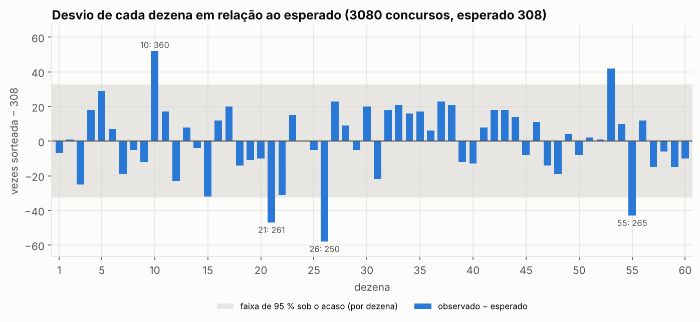
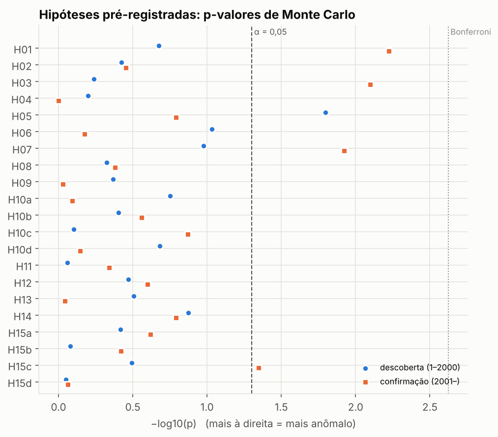
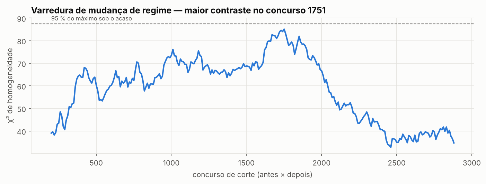
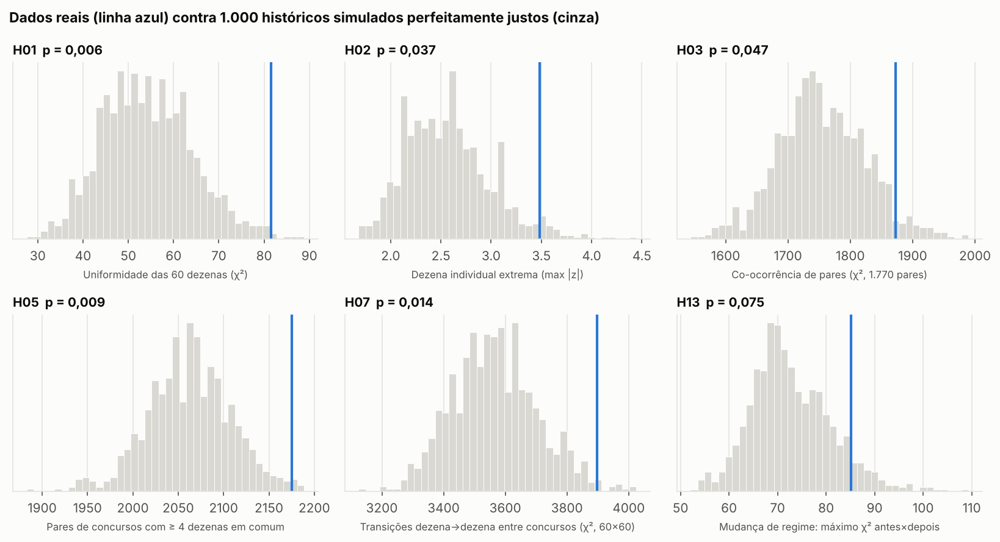
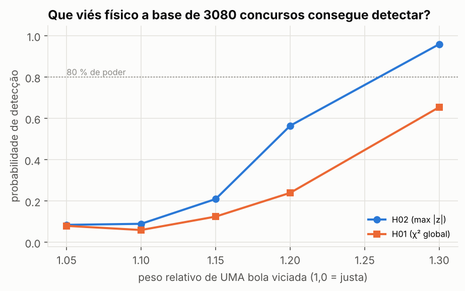
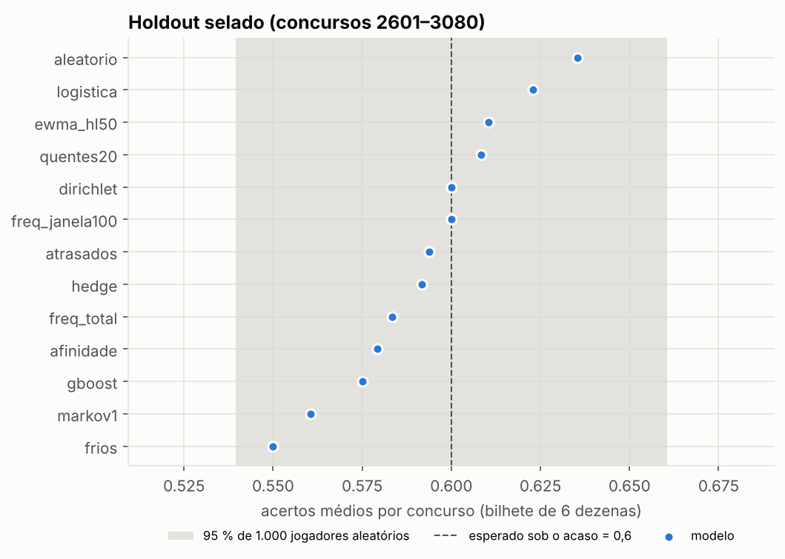
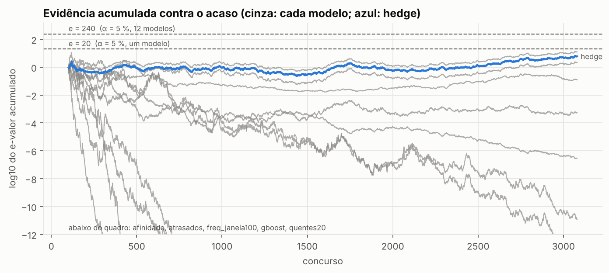

# MEGA LAB — Relatório de descobertas

*Gerado em 2026-11-03 07:38 UTC por `megalab report`. Base: 3.080 concursos (1 a 3080), SHA-256 `b1cc5ef432453a52…`. Sementes fixas; 1000 réplicas de Monte Carlo por teste.*

> Hipóteses, evidências e resultados dos experimentos. Regra fundamental: nenhuma descoberta é aceita sem evidência fora da amostra e comparação com uma linha de base aleatória.

## Sumário executivo

**Não encontramos nenhuma informação nos resultados passados que melhore a previsão da Mega-Sena em relação ao acaso.**

- **Base:** 3.080 concursos de 1996-03-11 a 2026-11-01, sem lacunas; 9 fontes independentes concordam em 100 % das dezenas (3066 concursos com ≥ 3 fontes, 14 com 2).
- **Aleatoriedade (21 hipóteses pré-registradas):** 1 com p < 0,05 no período de descoberta sem correção (esperado por acaso: ~1); **0 sobreviveram à correção de Holm**; **0 confirmada(s)** no período de confirmação.
- **Sinal exploratório (não é descoberta):** fora da sequência pré-registrada, 6 estatísticas ficam abaixo de 0,05 no período 2001–3080 ou na base inteira (H01, H02, H03, H05, H07, H15c). Quase todas reagem à mesma coisa — frequências um pouco desiguais entre dezenas (ex.: dezena 26 saiu 250 vezes contra 308 esperadas). Como não apareceu no período de descoberta, não pode ser declarado padrão; foi registrado como **H17** para teste exclusivamente em concursos futuros.
- **Bolas viciadas:** a base teria ≥ 80 % de chance de detectar uma bola com peso relativo 1,30 (que sairia ≈ 28 % mais vezes que o esperado). Vieses físicos menores que isso não podem ser descartados — mas também não poderiam ser explorados de forma útil.
- **Previsão (13 modelos, walk-forward):** no holdout selado (480 concursos), nenhum modelo superou o acaso após correção de Holm. Acertos médios entre 0,550 e 0,635 por bilhete (acaso: 0,600); o melhor resultado em acertos foi da própria linha de base aleatória (`aleatorio`).
- **Registro prospectivo:** livro-razão com 1 rodada(s) de previsões registradas antes do sorteio; 0 avaliada(s). Cadeia de hashes íntegra.

## 01 — Banco histórico

| Item | Valor |
|---|---|
| Concursos | 3.080 (1 a 3080) |
| Período | 1996-03-11 a 2026-11-01 |
| Concursos ausentes / duplicados | 0 / 0 |
| Status A (≥ 3 fontes) / B (2 fontes) / C / X | 3066 / 14 / 0 / 0 |
| Divergências de data | 1 (concurso 2955, resolvida pela maioria e pela planilha oficial) |
| Concursos com ordem de extração | 3.066 (2797 conferidos em 2 fontes, 100 % de concordância) |
| Regimes de calendário (inferidos) | 1x/semana: 1–280; 2x/semana: 281–2619; 3x/semana: 2620–3080 |
| Sorteios de fim de ano | 23 |

Detalhes: `docs/04_fontes_de_dados.md`, `data/canonical/integridade.json`, `data/sources/MANIFEST.json`.

## 02 — Estatística descritiva



- Probabilidades exatas de uma aposta simples: sena 1 em 50.063.860; quina 1 em 154.518; quadra 1 em 2.332.
- Soma média das dezenas: 183,04 (teórica 183,0).
- Combinações de 6 repetidas na história: 0 (esperado ≈ 0,09).
- Dezenas repetidas do concurso anterior (observado × esperado): 0: 1600 × 1588; 1: 1200 × 1167; 2: 252 × 292; 3: 25 × 31.

Dezenas mais afastadas do esperado (base completa, exploratório):

| Dezena | Frequência | Esperado | z | p bilateral | q (BH, 60 testes) |
|---|---|---|---|---|---|
| 26 | 250 | 308 | -3,48 | < 0,001 | 0,023 |
| 10 | 360 | 308 | +3,12 | 0,002 | 0,074 |
| 21 | 261 | 308 | -2,82 | 0,004 | 0,087 |
| 55 | 265 | 308 | -2,58 | 0,009 | 0,140 |
| 53 | 350 | 308 | +2,52 | 0,014 | 0,170 |

## 03 — Anomalias e testes de aleatoriedade



| ID | Hipótese | p descoberta | p Holm | p confirmação | p base completa (exploratório) | Veredito |
|---|---|---|---|---|---|---|
| H01 | Uniformidade das 60 dezenas (χ²) | 0,212 | 1,000 | 0,006 | 0,006 | compatível com o acaso |
| H02 | Dezena individual extrema (max |z|) | 0,378 | 1,000 | 0,352 | 0,037 | compatível com o acaso |
| H03 | Co-ocorrência de pares (χ², 1.770 pares) | 0,579 | 1,000 | 0,008 | 0,047 | compatível com o acaso |
| H04 | Trio mais frequente (máximo entre 34.220 trios) | 0,633 | 1,000 | 1,000 | 1,000 | compatível com o acaso |
| H05 | Pares de concursos com ≥ 4 dezenas em comum | 0,016 | 0,336 | 0,162 | 0,009 | compatível com o acaso |
| H06 | Repetição de dezenas do concurso anterior (χ²) | 0,093 | 1,000 | 0,667 | 0,053 | compatível com o acaso |
| H07 | Transições dezena→dezena entre concursos (χ², 60×60) | 0,106 | 1,000 | 0,012 | 0,014 | compatível com o acaso |
| H08 | Intervalos entre aparições vs. geométrica (χ²) | 0,475 | 1,000 | 0,417 | 0,257 | compatível com o acaso |
| H09 | Memória na soma das dezenas (Ljung-Box, 10 lags) | 0,431 | 1,000 | 0,931 | 0,481 | compatível com o acaso |
| H10a | Quantidade de dezenas pares por concurso (χ²) | 0,177 | 1,000 | 0,805 | 0,197 | compatível com o acaso |
| H10b | Quantidade de dezenas baixas 1–30 por concurso (χ²) | 0,396 | 1,000 | 0,277 | 0,277 | compatível com o acaso |
| H10c | Contagens por faixa 1–10 … 51–60 (χ²) | 0,787 | 1,000 | 0,135 | 0,345 | compatível com o acaso |
| H10d | Contagens por dígito final 0–9 (χ²) | 0,208 | 1,000 | 0,715 | 0,325 | compatível com o acaso |
| H11 | Dezena × posição na ordem de extração (χ², 60×6) | 0,873 | 1,000 | 0,456 | 0,564 | compatível com o acaso |
| H12 | Pares de dezenas consecutivas por concurso (χ²) | 0,339 | 1,000 | 0,253 | 0,196 | compatível com o acaso |
| H13 | Mudança de regime: máximo χ² antes×depois | 0,313 | 1,000 | 0,906 | 0,075 | compatível com o acaso |
| H14 | Deriva: variância do χ² em janelas de 200 | 0,134 | 1,000 | 0,162 | 0,119 | compatível com o acaso |
| H15a | Dia da semana × dezena (permutação) | 0,384 | 1,000 | 0,240 | 0,880 | compatível com o acaso |
| H15b | Sorteio de fim de ano (31/12 ou 01/01) × dezena (permutação) | 0,834 | 1,000 | 0,381 | 0,712 | compatível com o acaso |
| H15c | Concurso acumulado × dezena (permutação) | 0,322 | 1,000 | 0,045 | 0,206 | compatível com o acaso |
| H15d | Regime de calendário (1x/2x/3x por semana) × dezena (permutação) | 0,895 | 1,000 | 0,866 | 0,988 | compatível com o acaso |

Mudança de regime (H13): o maior contraste antes × depois ocorre no concurso 1751 (χ² = 85,1; 95 % do máximo sob o acaso = 87,5).



### Sinal exploratório e hipótese H17

Pela regra pré-registrada, nada foi confirmado: nenhuma hipótese passou na correção de Holm no período de descoberta (1–2000). Mas seria desonesto esconder o que aparece fora dessa regra:

- **H01** (Uniformidade das 60 dezenas (χ²)): p confirmação = 0,006; p base completa = 0,006.
- **H02** (Dezena individual extrema (max |z|)): p confirmação = 0,352; p base completa = 0,037.
- **H03** (Co-ocorrência de pares (χ², 1.770 pares)): p confirmação = 0,008; p base completa = 0,047.
- **H05** (Pares de concursos com ≥ 4 dezenas em comum): p confirmação = 0,162; p base completa = 0,009.
- **H07** (Transições dezena→dezena entre concursos (χ², 60×60)): p confirmação = 0,012; p base completa = 0,014.
- **H15c** (Concurso acumulado × dezena (permutação)): p confirmação = 0,045; p base completa = 0,206.

Leitura: H01, H03, H05 e H07 são estatísticas correlacionadas — todas aumentam quando algumas dezenas saem mais que outras. O conjunto aponta para **uma** possível causa (frequências levemente desiguais, concentradas em 2001–3080), não para várias descobertas. Na base completa, a dezena 26 tem z = -3,48 (q de Benjamini-Hochberg = 0,023 entre 60 dezenas). Contra isso: (1) o período 1–2000 não mostrou o efeito (H01 p = 0,212); (2) com 21 testes em C, o menor p-valor (0,006) vira 0,126 após Holm; (3) nenhum modelo transformou isso em mais acertos no holdout.

Por isso a hipótese foi registrada como **H17** (adendo 1 de `docs/03_protocolo_cientifico.md`, commit anterior à execução do backtest) e será julgada **apenas em concursos ≥ 3081** pelo e-valor prospectivo do modelo `freq_total` (limiar 20).
No holdout, `freq_total` acumulou log10 e = +0,57 em 480 concursos. Se esse ritmo se mantiver, H17 precisaria de ≈ 1.105 sorteios (≈ 7 anos a 3 por semana) para atingir e = 20 — ou seja, mesmo que o efeito seja real, ele é pequeno demais para ter valor prático.

## 04 — Machine learning

Dois modelos (regressão logística e gradient boosting) receberam 10 features causais por dezena (frequências em janelas de 10/50/200/total, atraso, presença nos 2 concursos anteriores, EWMA, afinidade e transição com o concurso anterior) e foram re-treinados a cada 100 concursos usando apenas o passado. Os testes `tests/test_no_leakage.py` provam que alterar o futuro não altera nenhuma feature nem previsão.

| Modelo | Período | Acertos médios | p (acertos) | bits/concurso | p (bits) |
|---|---|---|---|---|---|
| logistica | desenvolvimento | 0,599 | 0,518 | -0,0114 | 0,459 |
| logistica | validacao | 0,647 | 0,056 | +0,0056 | 0,013 |
| logistica | holdout | 0,623 | 0,246 | -0,0023 | 0,390 |
| gboost | desenvolvimento | 0,586 | 0,806 | -0,1387 | 0,978 |
| gboost | validacao | 0,597 | 0,555 | -0,0080 | 0,139 |
| gboost | holdout | 0,575 | 0,791 | -0,0234 | 0,844 |

Exemplo didático do risco de sobreajuste: a regressão logística parecia promissora na validação (acertos 0,647, p = 0,056; bits p = 0,013) e caiu no holdout (acertos 0,623, p = 0,246; bits -0,0023). Se tivéssemos escolhido o modelo pela validação e parado ali, teríamos anunciado um falso padrão.

## 05 — Monte Carlo



**Padrões no acaso puro.** Em 3080 concursos, a dezena mais sorteada saiu 360 vezes e a menos sorteada 250 (esperado 308); o par mais frequente saiu 43 vezes (esperado por par 26,1); o trio mais frequente saiu 8 vezes — nos históricos simulados justos o trio máximo fica entre 9 e 11 (90 % central), isto é, o trio campeão real é até menos repetido que o típico. "Dezenas quentes", "pares que saem juntos" e "trios campeões" aparecem naturalmente em qualquer sorteio justo.



| Peso da bola | Frequência relativa média | Poder H01 | Poder H02 |
|---|---|---|---|
| 1,05 | 1,048 | 0,08 | 0,09 |
| 1,10 | 1,090 | 0,06 | 0,09 |
| 1,15 | 1,130 | 0,12 | 0,21 |
| 1,20 | 1,188 | 0,24 | 0,56 |
| 1,30 | 1,275 | 0,66 | 0,96 |

## 06 — Backtesting (walk-forward, sem vazamento)



Holdout selado: concursos 2601–3080 (480 sorteios). p-valores unilaterais exatos (acertos: soma de hipergeométricas) e condicionais (bits); Holm sobre 24 testes.

| Modelo | Acertos | Esperado | p | Quadras | bits/concurso | p (bits) | log10 e-valor | Percentil entre aleatórios |
|---|---|---|---|---|---|---|---|---|
| aleatorio | 305 | 288 | 0,142 | 0 | +0,0000 | 1,000 | +0,00 | 86 % |
| freq_total | 280 | 288 | 0,708 | 0 | +0,0052 | 0,032 | +0,57 | 33 % |
| freq_janela100 | 288 | 288 | 0,510 | 0 | -0,1090 | 0,664 | -4,40 | 53 % |
| ewma_hl50 | 293 | 288 | 0,383 | 0 | -0,0881 | 0,741 | -3,57 | 65 % |
| quentes20 | 292 | 288 | 0,407 | 1 | -0,3883 | 0,846 | -13,31 | 62 % |
| frios | 264 | 288 | 0,945 | 0 | -0,0171 | 0,972 | -1,04 | 7 % |
| atrasados | 285 | 288 | 0,587 | 0 | -0,7884 | 0,127 | -24,24 | 45 % |
| dirichlet | 288 | 288 | 0,510 | 0 | +0,0051 | 0,032 | +0,51 | 53 % |
| markov1 | 269 | 288 | 0,898 | 1 | -0,0070 | 0,319 | -0,16 | 12 % |
| afinidade | 278 | 288 | 0,751 | 0 | -0,2169 | 0,642 | -9,00 | 28 % |
| logistica | 299 | 288 | 0,246 | 0 | -0,0023 | 0,390 | -0,02 | 78 % |
| gboost | 276 | 288 | 0,791 | 0 | -0,0234 | 0,844 | -1,15 | 24 % |
| hedge | 284 | 288 | 0,612 | 0 | +0,0051 | 0,032 | +0,51 | 43 % |

1.000 jogadores aleatórios no mesmo período: acertos totais entre 244 e 333 (95 % central: 259–317).

Modelos significativos após Holm: **nenhum**.



Desempenho por período (acertos médios por bilhete):

| Modelo | desenvolvimento | validacao | holdout |
|---|---|---|---|
| aleatorio | 0,573 | 0,630 | 0,635 |
| freq_total | 0,596 | 0,625 | 0,583 |
| freq_janela100 | 0,628 | 0,602 | 0,600 |
| ewma_hl50 | 0,614 | 0,593 | 0,610 |
| quentes20 | 0,577 | 0,567 | 0,608 |
| frios | 0,596 | 0,537 | 0,550 |
| atrasados | 0,584 | 0,568 | 0,594 |
| dirichlet | 0,595 | 0,628 | 0,600 |
| markov1 | 0,598 | 0,608 | 0,560 |
| afinidade | 0,583 | 0,588 | 0,579 |
| logistica | 0,599 | 0,647 | 0,623 |
| gboost | 0,586 | 0,597 | 0,575 |
| hedge | 0,589 | 0,632 | 0,592 |

## Registro prospectivo (livro-razão)

Última rodada registrada: concurso **3081**, em 2026-11-03T07:36:35Z (seq 1, hash `df36d3f2920c0d38…`), com a base até o concurso 3080.

| Modelo | Bilhete registrado |
|---|---|
| aleatorio | 23 26 47 49 51 54 |
| freq_total | 05 10 27 33 37 53 |
| freq_janela100 | 06 17 27 30 40 58 |
| ewma_hl50 | 05 06 27 40 43 58 |
| quentes20 | 04 05 10 28 41 57 |
| frios | 03 15 21 22 26 55 |
| atrasados | 15 21 26 42 46 56 |
| dirichlet | 05 10 27 37 38 53 |
| markov1 | 11 17 27 35 43 53 |
| afinidade | 13 17 28 29 39 58 |
| logistica | 23 30 35 36 38 43 |
| gboost | 09 30 36 41 45 48 |
| hedge | 05 10 27 37 38 53 |

Nenhum concurso prospectivo avaliado ainda. Após cada sorteio: `megalab data update && megalab ledger score && megalab ledger predict`.

## Relatório de descobertas

| # | Hipótese | Evidência | Resultado |
|---|---|---|---|
| 1 | **Integridade** — A base pública tem erros ou lacunas | 9 fontes, 3.080 concursos, 0 divergências de dezenas | Rejeitada: base íntegra |
| 2 | **Uniformidade** — Algumas dezenas saem mais que outras (H01, H02) | p_D = 0,212 / 0,378; p_C = 0,006 / 0,352 | compatível com o acaso |
| 3 | **Combinações** — Pares, trios ou combinações se repetem além do acaso (H03–H05) | H03: p_D = 0,579; H04: p_D = 0,633; H05: p_D = 0,016 | compatível com o acaso |
| 4 | **Memória** — O sorteio depende dos anteriores (H06–H09) | H06: p_D = 0,093; H07: p_D = 0,106; H08: p_D = 0,475; H09: p_D = 0,431 | compatível com o acaso |
| 5 | **Física das bolas** — Bolas saem em posições preferenciais da ordem de extração (H11) | 3.066 concursos com ordem; p_D = 0,873 | compatível com o acaso |
| 6 | **Equipamento / procedimento** — Houve mudança de regime ou deriva (H13, H14, H15d) | H13: p_D = 0,313; H14: p_D = 0,134; H15d: p_D = 0,895 | compatível com o acaso |
| 7 | **Fatores conhecidos** — Dia da semana, fim de ano ou prêmio acumulado influenciam (H15a–c) | H15a: p_D = 0,384; H15b: p_D = 0,834; H15c: p_D = 0,322 | compatível com o acaso |
| 8 | **Previsibilidade** — Algum modelo prevê melhor que o acaso (H16) | holdout 480 concursos, 12 modelos + hedge, Holm | Nenhum modelo superou o acaso |
| 9 | **Sinal exploratório H17** — Frequências desiguais entre dezenas (gerada pelos dados de 2001–3080) | p_C(H01) = 0,006; dezena 26: z = -3,48; freq_total no holdout: bits p = 0,032, acertos p = 0,708 | Não confirmada; em teste prospectivo (concursos ≥ 3081) |

## Limitações

- Concordância entre fontes não protege contra erro na origem (Caixa).
- Não havia registros oficiais datados de troca de globos/bolas; mudanças foram investigadas apenas por métodos que não dependem dessas datas (H13, H14, H15d).
- A base só detecta vieses físicos acima do limiar mostrado na análise de poder.
- Um modelo de linguagem pode ter visto resultados antigos; o teste definitivo é o prospectivo.
- Ausência de evidência em uma bateria finita de hipóteses não prova aleatoriedade perfeita; prova que nenhuma das hipóteses testadas oferece vantagem.

## Como reproduzir

```bash
cd mega_lab && pip install -e .[dev]
pytest                      # testes automatizados
megalab data check          # reconstrói a base a partir dos extratos e confere integridade
megalab analyze             # Família 1 (≈ 3 min)
megalab backtest            # Família 2 (≈ 5 min)
megalab report              # este relatório
```
